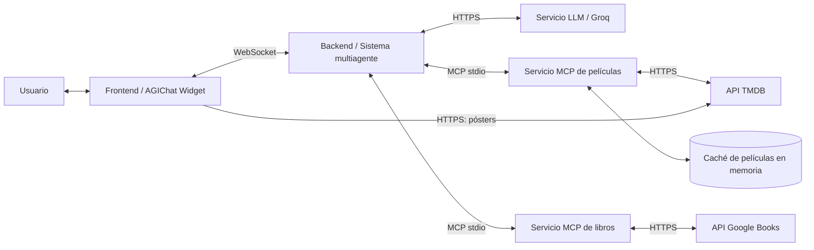
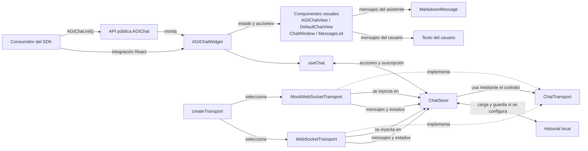
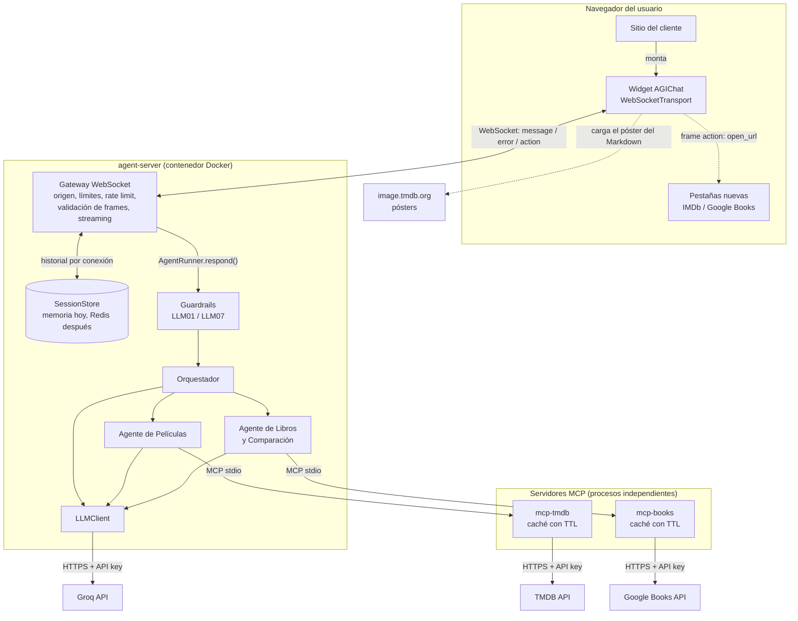

# Arquitectura de AGIChat Widget SDK

## 1. Descripción general

AGIChat Widget SDK es una biblioteca para integrar un chat con un agente en un sitio web. Puede usarse mediante la API pública `AGIChat`, que monta el widget en la página, o mediante el componente React `AGIChatWidget`.

La API `AGIChat` crea un contenedor con Shadow DOM para aislar los estilos del widget de los estilos de la página. La integración React permite usar el componente dentro de una aplicación React existente.

## 2. Arquitectura del proyecto

El proyecto se organiza en áreas funcionales. Cuenta con interfaz visual, lógica del chat, estado, transporte, tipos compartidos, estilos y pruebas. Puede entenderse como una arquitectura por capas funcionales; no son capas aisladas de forma estricta, pues los componentes React conectan la vista con la lógica mediante el hook `useChat`.

- **`AGIChatWidget`** recibe la configuración o un `ChatStore` existente, crea el store cuando hace falta y conecta la vista elegida con el estado y las acciones del chat. Por defecto usa `DefaultChatView`.
- **`useChat`** suscribe React al store mediante `useSyncExternalStore`, conecta y desconecta el transporte con el ciclo de vida del componente, y expone acciones como enviar, reintentar y limpiar.
- **`ChatStore`** conserva los mensajes y el estado de conexión, envía los mensajes del usuario, procesa eventos del transporte y reemplaza por ID los fragmentos acumulados de una respuesta en streaming. Puede recibir un historial opcional.
- **`ChatTransport`** define el contrato que el store usa para conectarse, desconectarse, enviar mensajes y suscribirse a eventos.
- **`MockWebSocketTransport`** implementa ese contrato para simular la conexión y entregar respuestas en fragmentos.
- **`WebSocketTransport`** implementa el contrato para comunicarse con un servidor WebSocket, procesar sus eventos y administrar reconexiones.

`createTransport` selecciona y crea la implementación concreta según la configuración. `createChatStore` obtiene de esa fábrica una instancia de transporte y se la pasa al constructor de `ChatStore`. El store depende del contrato `ChatTransport`, no de una implementación concreta.

No existe una clase Adapter separada. Lo que sí está implementado es un contrato común con transportes intercambiables, elegidos por `createTransport`. Así se puede cambiar el mecanismo de comunicación sin cambiar la lógica principal del store.

## 3. Diagrama de alto nivel (HLD del Proyecto 2)



El diagrama representa la arquitectura objetivo, no certifica que todos los servicios
estén integrados. MCP TMDB, pósters y créditos están implementados. El arranque actual
del backend todavía usa el agente de prueba; orquestación, Groq, Books y acciones
frontend quedan a cargo de las otras personas. La caché TMDB es local a cada proceso.

### 3.1 Detalle interno del SDK (bajo nivel)

El siguiente diagrama documenta implementación; no forma parte del HLD.



El consumidor puede inicializar el widget mediante `AGIChat.init()` o usar `AGIChatWidget` en React. El widget presenta el estado del chat mediante sus vistas y se conecta a `ChatStore` con `useChat`. La fábrica escoge uno de los transportes, que implementan el contrato utilizado por el store. Las vistas muestran el Markdown del asistente mediante `MarkdownMessage` y el texto del usuario de forma literal. El historial local participa solo cuando se configura la persistencia.

## 4. Flujo de un mensaje

Al inicializar el widget, `createStoreFromOptions` prepara las opciones y llama a `createChatStore`. Este obtiene una instancia mediante `createTransport` y la entrega al constructor de `ChatStore`. Esa selección del transporte ocurre antes de enviar mensajes.

El flujo de envío y respuesta es el siguiente:

1. El usuario escribe y envía un mensaje desde la vista.
2. La vista llama a la acción `onSend` que recibió del widget.
3. El widget conecta esa acción con `send` de `useChat`.
4. `useChat` delega el envío en `ChatStore`.
5. `ChatStore` agrega el mensaje del usuario al estado y lo envía mediante la instancia de `ChatTransport` que recibió al crearse.
6. La instancia es `MockWebSocketTransport` o `WebSocketTransport`, según la configuración seleccionada por `createTransport`.
7. El transporte emite eventos de mensaje y estado. Para una respuesta en streaming, los fragmentos con el mismo ID actualizan el mensaje existente en `ChatStore`.
8. `useChat` recibe el cambio de estado y React vuelve a renderizar la vista.
9. Si el mensaje es del asistente, `MessageList` o `DefaultChatView` presenta su contenido mediante `MarkdownMessage`.
10. Si el mensaje es del usuario, la vista presenta su contenido como texto normal.

Si se habilita `persistHistory`, `ChatStore` carga el historial al crearse, guarda mensajes completos y lo limpia cuando se solicita. La implementación predeterminada usa `localStorage` mediante `createLocalStorageHistory`.

## 5. Estructura de carpetas

```text
src/
├── components/       # Componentes visuales, incluida la lista y el renderer Markdown
├── core/             # Widget, API, hook, store, historial y lógica central
├── transport/        # Fábrica e implementaciones mock y WebSocket
├── types/            # Tipos compartidos, incluido Message y ChatTransport
├── styles/           # Estilos del widget React
└── test/             # Configuración compartida y transporte falso para pruebas

demo/                 # Aplicación demo e integración del script embebible
docs/                 # Documentación del SDK, transporte, arquitectura y despliegue
packages/             # Backend del proyecto 2 (npm workspaces), ver la sección 9
├── agent-server/     # Gateway WebSocket, sesiones, configuración y agentes
├── mcp-tmdb/         # Servidor MCP de películas (TMDB)
└── mcp-books/        # Servidor MCP de libros (Google Books)
.github/workflows/    # Automatización de CI, despliegue y release
```

Las pruebas unitarias y de componentes se encuentran junto a los módulos correspondientes con nombres `*.test.ts` o `*.test.tsx`. `src/test/` contiene utilidades compartidas, no todas las pruebas.

## 6. Cómo escalar el proyecto

- Agrega nuevos componentes visuales en `src/components/` y conéctalos mediante las vistas existentes cuando corresponda.
- Agrega lógica que coordina el chat en `src/core/`, manteniendo el estado centralizado en `ChatStore` cuando deba compartirse entre vistas.
- Coloca tipos públicos o compartidos en `src/types/`. Si un tipo debe formar parte de la API pública, expórtalo desde los puntos de entrada correspondientes.
- Agrega transportes en `src/transport/` implementando `ChatTransport` y registra su selección en `createTransport`.
- Coloca cada prueba junto al módulo que verifica y reutiliza las utilidades de `src/test/` cuando sean aplicables.
- Mantén los estilos del widget React en `src/styles/` y los estilos predeterminados que se insertan en el widget embebible en `src/core/defaultStyles.ts`.

## 7. Decisiones arquitectónicas

- **Interfaz separada de comunicación:** las vistas reciben mensajes y acciones; no necesitan conocer el protocolo WebSocket ni cómo se simula una respuesta.
- **Transporte intercambiable:** `ChatStore` usa el contrato `ChatTransport`. `createTransport` concentra la selección entre mock y WebSocket, de modo que las implementaciones puedan sustituirse sin cambiar el flujo principal del store.
- **Pruebas aisladas:** el store puede probarse con `FakeTransport`, y los componentes visuales pueden verificarse con mensajes y acciones de prueba sin establecer una conexión real.
- **Crecimiento ordenado:** las carpetas reflejan responsabilidades existentes y permiten agregar componentes, lógica, tipos, transportes y pruebas en el área correspondiente.
- **Integración flexible:** `AGIChatWidget` permite integrarlo en una aplicación React; la API `AGIChat` monta el mismo widget para sitios que usan el script embebible y lo aísla con Shadow DOM.

## 8. Renderizado Markdown y seguridad

Los mensajes del asistente se presentan con `MarkdownMessage`, tanto en `MessageList` como en `DefaultChatView`. El renderer usa `react-markdown` con `remark-gfm` para tablas y otras extensiones de GitHub Flavored Markdown. `rehype-highlight` resalta bloques de código cuando el bloque indica un lenguaje.

El contenido recibido se trata como no confiable. `rehype-sanitize` sanitiza el árbol renderizado y no se habilita HTML crudo mediante `rehype-raw`. Los mensajes del usuario no pasan por el renderer Markdown y permanecen como texto normal.

## 9. Sistema de agentes: detalle de componentes y arquitectura objetivo

En el proyecto 2 la widget deja de hablar con el mock y se conecta a un **sistema multiagente** que recomienda películas con TMDB y las compara con su libro en Google Books. El backend vive en `packages/` como npm workspaces y la widget no cambia de arquitectura. Solo usa `WebSocketTransport` con el endpoint del servidor y recibe un frame nuevo, `action`, definido en [TRANSPORT.md](TRANSPORT.md).

Esta sección conserva el detalle técnico de la arquitectura objetivo, separado del HLD de la sección 3. Algunas piezas de Personas 3, 4 y 5 siguen pendientes de integración.

### 9.1 Diagrama de componentes (detalle técnico)



### 9.2 Piezas y responsabilidades

| Pieza                                | Dónde                                      | Responsabilidad                                                                                                                                                                                |
| ------------------------------------ | ------------------------------------------ | ---------------------------------------------------------------------------------------------------------------------------------------------------------------------------------------------- |
| Widget                               | `src/`                                     | Muestra la conversación, renderiza el Markdown sanitizado (con los pósters) y abre las pestañas que pide el frame `action`. **No conoce ninguna API key.**                                     |
| Gateway WebSocket                    | `packages/agent-server/src/gateway`        | Valida el origen, el tamaño y la forma de cada frame. Aplica los límites. Convierte los eventos del agente en snapshots de streaming. Detecta clientes muertos. No sabe nada de LLM ni de MCP. |
| `SessionStore`                       | `packages/agent-server/src/session`        | Guarda el historial de cada conversación con TTL y un tope de mensajes. Es una interfaz asíncrona; hoy se implementa en memoria.                                                               |
| Contrato `AgentRunner`               | `packages/agent-server/src/agent/types.ts` | Es el único punto de contacto entre el gateway y los agentes: `respond({ sessionId, history, input, signal })` devuelve un flujo de eventos `text` y `action`.                                 |
| Guardrails, orquestador y subagentes | `packages/agent-server` (P4 y P5)          | Deciden qué responder, a qué subagente delegar y qué herramientas usar. Filtran la entrada y la salida contra inyección de prompt y filtración del prompt de sistema.                          |
| `LLMClient`                          | `packages/agent-server` (P4)               | Abstrae el proveedor (Groq). En tests se usa `FakeLLM`.                                                                                                                                        |
| Servidores MCP                       | `packages/mcp-tmdb`, `packages/mcp-books`  | Exponen las herramientas de películas y libros con esquemas `zod`. Guardan en caché las respuestas de las APIs externas.                                                                       |

### 9.3 Flujo de un turno

1. El usuario escribe en la widget. `WebSocketTransport` manda `{ "type": "message" }` al gateway.
2. El origen ya se revisó al abrir la conexión (403 si no está permitido), y un frame más grande que `MAX_PAYLOAD_BYTES` cierra la conexión. El gateway valida cada frame: JSON, forma, rol `user`, largo, mensajes vacíos y rate limit. Si algo falla, responde con un mensaje completo del asistente más un frame `error`, sin cerrar la conexión.
3. El turno entra en la cola de la conexión, así que una conexión procesa un turno a la vez. El gateway lee el historial del `SessionStore`, guarda el mensaje nuevo y llama a `AgentRunner.respond()`.
4. El orquestador, detrás de los guardrails, delega en los subagentes. Ellos llaman al LLM y a las herramientas MCP, que consultan TMDB o Google Books (o su caché).
5. Cada evento `text` se acumula y el gateway manda un snapshot con el mismo `id`, como mucho cada 50 ms. Cada evento `action` se valida (URL `https` y etiqueta corta) y se reenvía a la widget.
6. Al terminar, el gateway manda el snapshot `complete` y guarda la respuesta en la sesión. Si el usuario se desconecta a la mitad, el `AbortSignal` detiene al agente para que no siga gastando requests.

### 9.4 Por qué escala

- **El gateway se puede replicar horizontalmente.**
  - Una sesión vive lo mismo que su conexión WebSocket, y esa conexión siempre está en la misma instancia. Por eso varias réplicas detrás de un balanceador funcionan sin compartir estado ni usar sticky sessions: cada conexión nueva puede caer en cualquier réplica.
  - La configuración sale de variables de entorno.
  - El servidor expone `/health` para el balanceador y se apaga de forma ordenada con `SIGTERM`: cierra cada conexión con el código 1001, y la widget, que ya maneja reconexiones, vuelve a conectarse a otra réplica.
  - `MAX_CONNECTIONS` acota la carga de cada réplica, así que la capacidad crece agregando réplicas.
- **Las sesiones son intercambiables.**
  - El gateway solo conoce la interfaz `SessionStore`, que ya es asíncrona.
  - Si se quiere que una conversación sobreviva a una reconexión o a un reinicio, se cambia `InMemorySessionStore` por una implementación con Redis sin tocar el gateway ni los agentes.
- **Los agentes están desacoplados del transporte.**
  - El gateway solo depende de `AgentRunner`. Se puede cambiar el modelo, el proveedor de LLM o la organización de los agentes sin tocar el gateway ni la widget.
  - Las pruebas usan `EchoAgent` o `FakeLLM` sin gastar requests reales.
- **Los servidores MCP son independientes y reutilizables.**
  - Cada uno es un paquete y un proceso aparte, con su propia caché y sus tests.
  - Cualquier otro agente o cliente MCP puede usarlos sin conocer este proyecto.
  - Hoy se conectan por stdio dentro del mismo contenedor. Si la carga lo pide, el mismo servidor puede exponerse por HTTP y escalar por separado del gateway.
- **La caché y los límites cuidan los recursos más escasos.**
  - Las cuotas gratuitas de Groq, TMDB y Google Books son el verdadero cuello de botella, no la CPU.
  - La caché con TTL de los MCP evita repetir consultas.
  - El rate limit por conexión, la cola máxima de mensajes, el largo máximo de mensaje y el tope de historial limitan cuántas requests y tokens puede gastar un solo usuario.
  - El `AbortSignal` corta el trabajo de las conexiones que se cierran.
- **El streaming es barato.**
  - El throttle de 50 ms agrupa los fragmentos del LLM en pocos frames. Cada snapshot trae el texto acumulado completo, así que la widget solo reemplaza el mensaje por `id` y no tiene que reensamblar fragmentos.
  - El heartbeat ping/pong libera las conexiones muertas.
- **Hay seguridad en el borde.**
  - La allowlist de `Origin`, el `maxPayload` y la validación con `zod` rechazan el tráfico inválido antes de que llegue a los agentes.
  - Las API keys solo existen en el servidor, nunca en la widget ni en la imagen Docker.

### 9.5 Límites actuales

- El `SessionStore` es en memoria, así que una conversación se pierde al reconectar. Por eso la demo no guarda historial en el navegador cuando usa el agente real.
- El rate limit es por conexión y el contador de cuotas de cada MCP es por proceso. Con varias réplicas, un límite global (por ejemplo, requests diarias de Groq) necesitaría un contador compartido, como Redis.
- El servidor corre localmente o en Docker (ver [DESPLIEGUE.md](DESPLIEGUE.md)). La imagen está lista para cualquier plataforma que acepte contenedores con WebSockets.

```

```

### Integración de películas y atribución

El contrato de las tres herramientas, errores y configuración está en
[packages/mcp-tmdb/README.md](../packages/mcp-tmdb/README.md). El MCP entrega poster_url
lista para Markdown e imdb_url lista para un enlace; no construye prompts ni abre pestañas.
MarkdownMessage solo renderiza pósters HTTPS de image.tmdb.org bajo /t/p/w500/,
sin credenciales, puertos personalizados, query ni fragmento. Mantiene HTML crudo
bloqueado y sustituye imágenes inválidas o fallidas por texto alternativo.

TmdbAttribution coloca el logo oficial proporcionado, sin alterar sus bytes ni proporciones,
en Créditos de ChatWindow y DefaultChatView. El aviso es:
"This product uses the TMDB API but is not endorsed or certified by TMDB."
El enlace apunta a https://www.themoviedb.org con noopener noreferrer.
El logo se incluye en el SDK y embed; no proviene de Markdown generado por el agente.
