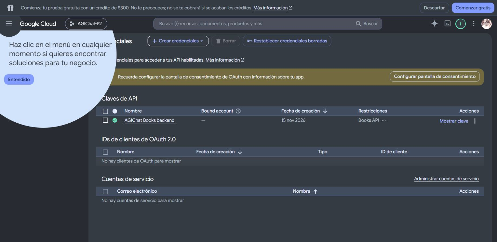
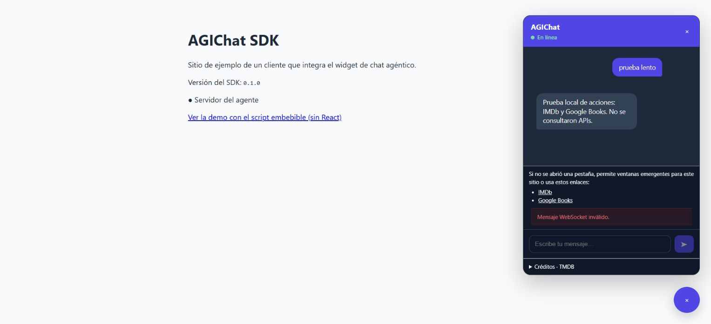
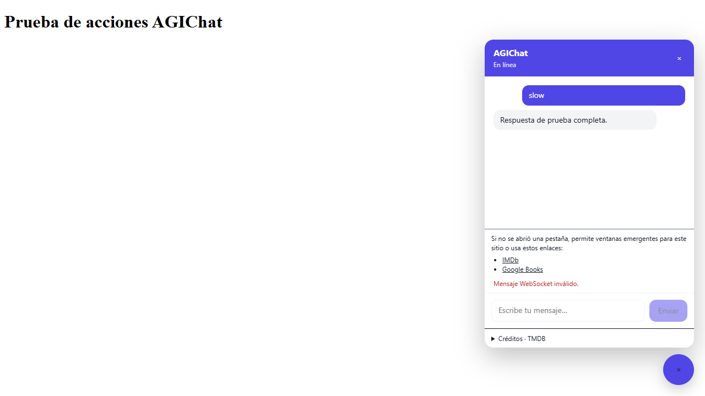
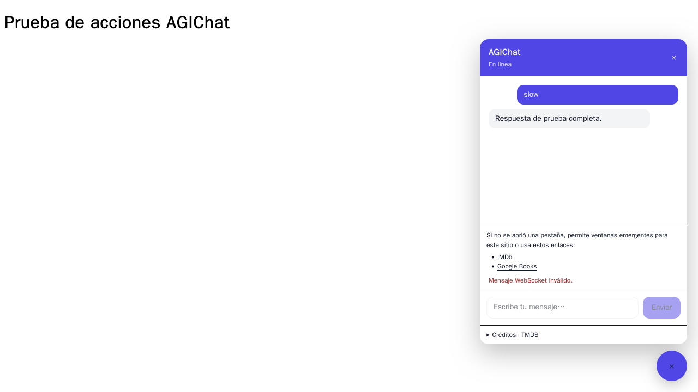

# Evidencias de Persona 3

Fecha: **15 de noviembre de 2026**. Código funcional verificado: **`0f55dc1`**.
Este directorio conserva capturas reales y salidas de ejecución; no incluye la API key,
archivos `.env`, cookies ni perfiles del navegador.

## Capturas

### Google Books configurado

Proyecto AGIChat-P2 y credencial restringida a **Books API**. La clave no está visible.
La captura acredita la restricción de API; no muestra una prueba de consulta ni una
pantalla de facturación.



### Widget en Edge

Demo React conectada al gateway real con un agente falso. La respuesta se retrasó
6.5 segundos y quedaron disponibles los enlaces de IMDb y Google Books.



### Widget en Chrome y Firefox

El embed compilado recibe acciones mediante el gateway real y un runner falso local.
Estas capturas corresponden al caso de respuesta tardía con rechazo simulado de
`window.open`, para comprobar que los enlaces permanecen accesibles.





**El aviso rojo “Mensaje WebSocket inválido” es intencional**: el runner también envía
una acción a `https://example.com/untrusted`. La widget debe rechazarla y mostrar
solo los dos enlaces permitidos. No corresponde a un fallo de la consulta de libros.
Las capturas por sí solas no acreditan la apertura de pestañas: eso se comprueba con
las aserciones y salidas de las pruebas enlazadas abajo.

## Resultados reproducibles

| Evidencia                                                                    | Qué demuestra                                                                                                                                                                                                                  |
| ---------------------------------------------------------------------------- | ------------------------------------------------------------------------------------------------------------------------------------------------------------------------------------------------------------------------------ |
| [CI local y pruebas](resultados/ci-y-pruebas.txt)                            | Lint, formato, tipos, cobertura, build y 340 pruebas; el final del archivo conserva los códigos de salida de `npm run ci` y `npm test`. Se ejecutaron en una copia limpia sin credenciales ni el documento local ajeno al SDK. |
| [Cobertura por paquete](resultados/cobertura.json)                           | Totales derivados de los reportes V8: widget y cada paquete superan el 80 % en las cuatro métricas exigidas.                                                                                                                   |
| [Chrome](resultados/chrome.txt) y [estado](resultados/chrome-status.json)    | Dos casos aprobados en Windows: dos aperturas automáticas sin duplicados y respaldo cuando se rechaza la apertura.                                                                                                             |
| [Firefox](resultados/firefox.txt) y [estado](resultados/firefox-status.json) | Los mismos dos casos aprobados en el entorno Linux oficial de Playwright, mediante la imagen Docker de pruebas.                                                                                                                |
| [Consulta real por MCP](resultados/books-mcp-real.json)                      | Descubrimiento de las tres herramientas, búsqueda real de Dune/Frank Herbert, detalles de un volumen y preparación de comparación mediante MCP stdio.                                                                          |
| [Health de Docker](resultados/docker-health.json)                            | La imagen local del agente arranca, responde `status: ok` y no contiene el `.env` local de Books. Incluye el ID de la imagen ejecutada.                                                                                        |

En Books, la cobertura es **99.4 % líneas, 100 % funciones, 94.2 % ramas y
99.49 % sentencias**. Los comandos de navegador usan un runner falso e interceptan
los destinos HTTPS; las pruebas y la CI no llaman Google Books, TMDB ni Groq.

La consulta real de Books fue **manual y separada de la suite y del CI**. El volumen
consultado no devolvió rating ni cantidad de valoraciones; se conservan como `null`.
El rating de película `8` es una entrada controlada para comprobar el contrato de
comparación, no una valoración obtenida de TMDB. `relationship: 'candidate'` tampoco
confirma una adaptación literaria ni constituye el veredicto del agente.

## Cómo repetir la verificación

```bash
npm ci
npm run ci
npm test
npx playwright install chrome firefox
npm run test:browser
```

Si Firefox no inicia en Windows por el error de ensamblado `mozglue`:

```bash
npm run test:browser -- --project=chrome-*
npm run test:browser:firefox:docker
```

Los casos están en [tests/browser](../../../tests/browser), y los contratos y la
configuración de la consulta manual están en la [guía del MCP de libros](../../../packages/mcp-books/README.md).
El job de navegadores de GitHub Actions conserva el artefacto `browser-test-results`
tanto si las pruebas pasan como si fallan, para descargar las capturas y el estado
de cada ejecución sin depender de las imágenes de esta entrega.
Las capturas originales fueron copiadas sin alterar su contenido. Los JSON de
cobertura resumen reportes generados, en lugar de incluir rutas absolutas del equipo.
En los logs de texto solo se normalizaron los saltos de línea y los espacios finales.

El log de build conserva el aviso de tamaño de bundle. Los logs de Chrome pueden
mostrar el aviso de variables de color de la terminal; ninguno cambia los resultados
aprobados. Estas evidencias no acreditan todavía el flujo completo con el orquestador
Groq, cuya integración corresponde a Persona 4.
